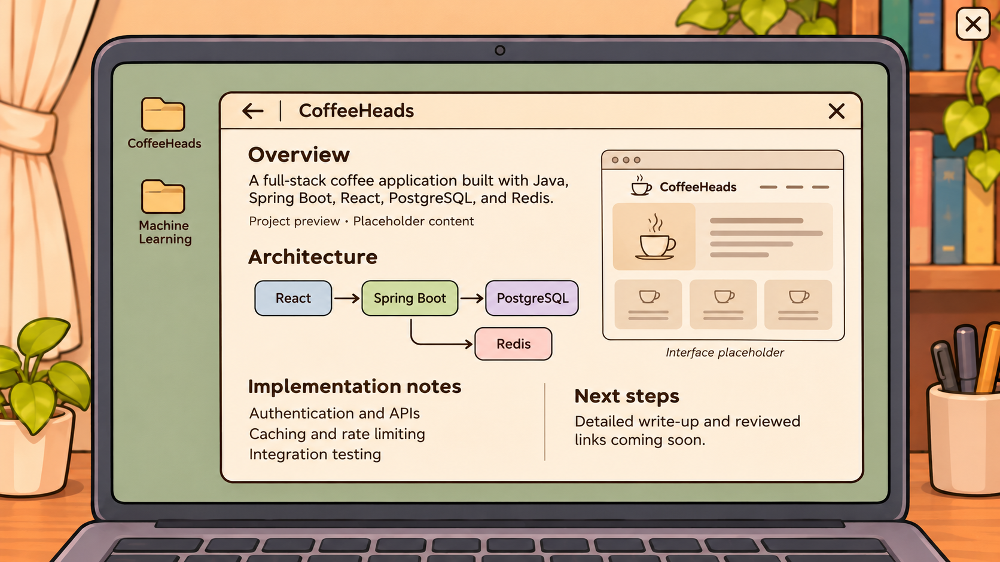

# Sili's Little House — Project Handoff

Updated: November 16, 2026 (America/Chicago)
Workspace: /Users/lisili/sili-portfolio
Repository: https://github.com/lisili0525/sili-portfolio
Website: https://silispace.net/

## Workstation split publication — November 16, 2026

The owner explicitly authorized committing and pushing all current local changes and checking the deployed website. This release includes the computer/notebook content split, its regression tests, the saved computer concept, and the desktop-first architecture proposal in `update.md`. The concept and architecture proposal remain documentation only; the personalized computer UI, notebook page turning, and renderer migration are not implemented. Earlier unpublished/no-push statements below describe the historical state before this authorization. Future publishing still requires explicit owner approval. Deployment success must be established from the matching GitHub Pages workflow and live-site checks.

## Computer concept review — November 16, 2026 (local, not implemented)

The owner responded positively to the latest computer concept and asked to save this discussion and image for continuation. This accepts a visual direction for further work, not authorization to implement the personalized computer view, push, or deploy. Resume with the computer; the notebook is a later, separate task.

Latest concept: [Computer project view v3](concepts/computer-project-view-v3.png).

### Confirmed direction and feedback

- Opening an object should feel like an enlarged view of that actual object. The owner referenced the existing album only for its viewport occupancy, not its appearance or book interaction.
- Only computer and notebook are in scope. The album is considered finished for now: do not alter it until the owner explicitly requests a change. Other content views remain unchanged.
- Keep the same cartoon drawing language as the room. Different object shapes are welcome; uniform shells are not a requirement.
- The computer contains CoffeeHeads and biomedical machine learning; the notebook contains SVD & PCA and cloud microphysics modeling. No new source information is supplied. Explicit English placeholder content is acceptable; do not invent results or evidence.
- Computer projects should open like individual folders. Keep desktop folder icons small, ordinary and simple, with ample empty desktop space. Do not display “Sili’s Computer” or another decorative desktop heading. Earlier oversized pictorial folders and busy floral/cloud decoration were rejected.
- The open-project window can be richer than the desktop. The current concept includes an overview, a compact architecture diagram, implementation notes and a clearly marked interface placeholder. These illustrate layout only; the diagram and mock screenshot are not independently verified project evidence or final content requirements.
- Perspective must correspond to sitting in the existing work chair and looking at the laptop. Behind the laptop: the wooden bookshelf on the right, a small area of warm wall, and part of the cream curtain on the left. Do not substitute a generic room background or repeat the original wide room composition.
- Notebook should eventually support page turning. Its personalized design and behavior have not been discussed in detail or implemented.

### Concept provenance and implementation boundaries

The saved PNG was generated with the built-in imagegen tool, not the CLI. References: `assets/room-workstation-no-pen-v1.png` for room layout/style and the previous simplified two-state computer concept for interface direction. The old room reference is a visual reference only; it does not authorize restoring its obsolete contact icons or other superseded artwork.

Prompt specification: create one landscape, nearly front-facing enlarged laptop project view; preserve warm outlined 2D cartoon rendering; laptop fills roughly 85–90% of the width; retain a little keyboard/desk; align curtain/wall/bookshelf background with the seated viewpoint; show two small CoffeeHeads and Machine Learning folders on muted sage wallpaper; open a large cream CoffeeHeads window with modest typography, overview, compact React/Spring Boot/PostgreSQL/Redis diagram, implementation notes, next steps and a labeled interface placeholder; omit desktop heading, ornamental wallpaper, album motifs and invented results. English text only.

This PNG is a concept reference under `concepts/`, not a production UI asset. It is not imported by the app. Final responsive layout, scrolling, inner-window navigation and close behavior, keyboard focus and music-control placement still require a concrete plan and owner approval before implementation. Preserve all existing music/mute/pause/saved-progress behavior, arrival gating, Escape, focus restoration and reduced motion. Generated foreground plants, stationery and exact dimensions are incidental, not approved changes to room composition.

The module split below is already implemented locally. No personalized computer UI, notebook page-turn UI, push or deployment has occurred. Existing 50-test/build validation applies to the split, not to this raster concept or future UI.

## Local workstation split — November 16, 2026 (unpublished)

The owner approved separating the computer and notebook before designing their personalized views. There are now eight content entries. The computer opens `computer`, rendered by `src/components/content/ComputerContent.jsx`, with CoffeeHeads and biomedical machine learning. The notebook retains `notebook`, rendered by `src/components/content/NotebookContent.jsx`, with SVD & PCA and cloud microphysics modeling. Both have separate Explore destinations. The coffee journal's technical link opens the computer. English placeholder notes are explicit; they make no new project claims.

Both entries retain the existing cream content shell and shared workstation journey, seating, departure and reduced-motion behavior. Dialog focus, Escape, arrival gating and piano browsing remain shared. The photo album is out of scope and must not be changed unless the owner explicitly requests it.

Next: continue from the saved computer concept review above and agree on an implementation plan. Notebook page turning is a later, separate design task. Neither final personalized view is implemented or approved. The enlarged presentation should occupy the viewport similarly in scale to the existing album, without making the computer resemble an album. No push or deployment is authorized.

Validation: all 50 tests across six suites pass, production build passes, and diff checks pass. New integration checks cover separate content and Explore entries, workstation arrival, focus return, pending Escape cancellation, reduced motion and uninterrupted music browsing. Native browser verification of this split has not been performed.

## Current delivery

The application is a React 19 / Vite 8 illustrated-room portfolio, published through GitHub Pages from main. Publishing requires explicit owner approval for each update; see Required publishing approval below. Earlier private-only, buildless, local-only and no-deployment notes are obsolete. Keep code, comments, documentation and generated prompts in English, even when discussing changes in Chinese. Never discard unrelated work or force-push.

This handoff describes the final implementation; PRD.md records product requirements. Deployment status is established by the matching GitHub Actions run and remote commit, rather than a speculative success statement in this document.

## Architecture and commands

- App.jsx owns content, Explore, focus, dialog sequencing, album spread state and fullscreen controls.
- useRoomRuntime starts and disposes the piano, cat and journey controllers. React StrictMode must retain only the existing two continuous animation clocks.
- controllers/journeys.js owns interruptible person movement, props, activity poses and arrival promises. controllers/piano.js owns recording/performance state. controllers/cats.js owns autonomous routes and coordinated meetings.
- components/Room.jsx composes independent scene modules over assets/room-architecture-v3.png. src/scene/README.md describes ownership, state and artwork sources. /?demo=modules provides enlarged coffee/window previews.
- src/scene/furnitureCatalog.js and sceneObjects.js share the 1672 x 941 world, module placement, artwork masks and furniture support anchors. src/data/catSurfaces.js derives resident destinations from those anchors.
- styles.css retains calibrated actor/depth geometry; scene.css and roomAnimations.css own module effects. Keep foreground passes as direct siblings of the person where CSS depth selectors require it.
- npm ci installs dependencies; npm run dev serves localhost; npm test runs Vitest; npm run build emits dist; npm run preview serves the production build. Use a Node version allowed by package.json; deployment uses Node 24.
- .github/workflows/deploy-pages.yml installs, tests, builds and publishes dist on pushes to main. Vite uses a relative base and emits only referenced production artwork. Do not deploy source files or the repository root as the site artifact.

## Interaction and popup rules

Eight local content entries remain: piano/music, coffee, computer, notebook, photos, calendar/milestones, tennis and resident cats. Illustrated objects retain tight contour highlights and accessible native controls. All floating object-name labels have been removed, including At the piano and Rachel & me. Window/curtain controls are on the artwork; no floating state toolbar is allowed. Explore provides alternative access to all entries.

Normally, content opens only after Sili reaches the selected destination and completes its initial interaction. Coffee waits through preparation, notebook waits for seating, album waits for pickup, and calendar/tennis wait for their arrival pose. Music content waits for piano arrival. New selections close old content, cancel obsolete journeys and suppress stale dialog promises. Repeated clicks on the same pending destination reuse its arrival promise. Escape cancels pending journeys. Programmatic dialog close events cannot cancel the next destination or restore obsolete focus.

During playing or an initial piano approach, other content opens immediately and Sili remains in the piano performance. An active initial piano approach also retains this browsing behavior; paused performances release Sili for physical interactions while retaining audio progress. The album opens without physical pickup in this mode. Compact music controls remain accessible in content. Direct cat greeting is a physical interaction and can interrupt the performance; browsing the resident introduction does not. Closing content never stops music.

The supplied One Summer's Day recording is the only track. On November 16, 2026, its asset was replaced byte-for-byte with the owner's revised M4A (136.04 seconds, stereo AAC at 44.1kHz), keeping the title and assets/music/one-summers-day.m4a path. Never autoplay on initial load. Start at arrival after visitor activation; show explicit playback fallback if blocked. The bottom-right icon-only music button toggles Mute/Unmute only and never starts playback or opens the piano dialog. The illustrated piano and its Explore destination own piano navigation. There is no separate Music list control. Playback actions are Mute/Unmute and Pause; paused playback offers Continue or Start over. Mute keeps audio advancing and character motion active; Pause preserves audio.currentTime and freezes the current playing pose using the inactive class. Continue resumes audio at its saved position and restores motion; Start over resets the selected track to zero. Selecting another destination while paused detaches the character and saves progress. Returning to the piano walks Sili back but stays paused until a choice is made. Recording end releases performance. Hiding the page uses the same pause path and requires an explicit playback action. Internal stop remains for recording end, errors, cancelled travel and physical departures; it is not exposed as a control. Reject late play promises after stop/disposal.

## Modular scene and visual corrections

Independent modules cover piano/bench, coffee equipment/cabinet, portrait/calendar, tennis equipment, stool, bookcase, workstation/chair/laptop/notebook/stationery/lamp/books, sofa, table/album, wall shelf/camera, toy mouse, plants, lighting and residents. SVG artwork uses geometric clip paths with small offset copies for edge padding, avoiding full-stage alpha-mask buffers and morphology filters during animation; future per-object animation should stay in its owning module.

The approved room source is assets/room-clean-v7.png. Reconstructed occluded surfaces are in room-hidden-surfaces-v1.png; neutral architecture and independent sunlight are separate assets. Closed glass and curtain states have versioned sources. Generation provenance is in assets/modular-room-prompts.md. Historical artwork remains unless explicitly deleted by the user.

The original room revisions removed the vine beside the espresso machine, the window vine and the lower-right foliage, added matching left/right curtains, corrected outward-opening casements and tuned window width while retaining its height. Preserve the approved final composition.

The window stool now uses separate tread/leg/rung clips with transparent gaps instead of carrying old wall/floor pixels. Desktop props and the desk surface consistently use room-workstation-no-pen-v1.png; their adjoining boundaries are aligned, and per-piece edgePadding allows tighter extraction without altering global clip behavior.

Latest mask corrections restore full desk legs and remove floating floor-colored rectangles, retain the right curtain's dark edge, fill bookcase/book gaps, restore the piano's left side and the album's lower-left cover. The bookcase plant is deliberately static until it can be isolated without carrying wall/shelf fragments; do not casually re-enable its wind class. Other airflow effects remain active. Piano hover geometry follows the corrected cabinet. The painted yellow rail has a local sepia/saturation/brightness treatment for warmer, subdued brass, not a black stripe or glowing yellow band.

Window glass and curtains toggle independently. Fabric breeze depends on open glass; closing the glass stops it. Drawn curtains remove direct sunlight and add subtle shade. Cats cannot cross closed glass or drawn curtains, and outdoor Viola waits until access returns. Do not close either state during an active crossing. Lamp toggles locally; camera flashes locally; coffee preparation drives steam/flow/pulse. Other paper, screen, plant and lighting effects stay restrained and honor inactivity/reduced motion.

## Character calibration

All seven person atlases stay mounted on separate sprite surfaces and are decoded at startup. Activity changes select visibility instead of replacing a background image. Zero-duration route markers are consumed within the same animation tick, without a transient idle frame.

Standing uses sili-poses-v1.png, four 543 x 724 cells at 58% stage height. Walking uses the dedicated six-frame sili-walk-v2.png atlas; see Six-frame short-step walking below. Activity atlases use calibrated 576px cells at 58.4%. Keep the approved apparent head scale and grounded feet. The calendar pointing cell (interactions frame 5) has more transparent padding: scale its sprite by 1.1 around 50% / 95.66%, without moving its feet or scaling every interaction pose.

Piano seated/playing uses sili-piano-v4.png at its existing 51.91% height and bench registration. Workstation computer-v3 and writing-v2 keep their approved seated calibration. Do not shrink actors to compensate for furniture. The chair is a separate alpha asset; foreground occlusion remains calibrated.

Foreground album pickup uses 53 / 96 via 53 / 84 and up to 18% perspective growth with anchored feet. The real tabletop silhouette hides the lower legs; the empty-table source removes the room book while held. Return on close/departure; leave piano-mode browsing exempt from pickup. Coffee uses only brew A/B, lean and sip cells in sili-coffee-v3.png; never restore the rejected twisted-head placement pose.

## Cats and person interaction

Viola and Java are female, visually distinct and autonomous. Java remains indoors; Viola can leave and return through the visible window route. Both visit piano bench/top, coffee counter/table, bookcase, work desk/chair, sofa and window using shared support anchors, reservations and stepped hops. Occupied furniture clears safely for the person.

src/data/catBehavior.js sets roaming rates to Viola 0.5 and Java 0.7 relative to the previous baseline. Longer indoor rests reduce excursion frequency by 50% and 30%; walking/jumping speed, greeting responsiveness and outdoor waiting are not slowed.

Direct cat clicks greet in-scene, without opening a biography. Explore retains Viola & Java, Pet Viola and Play with Java. Stable interaction handles expose identity, live geometry, readiness, contact, cancellation and departure. Journeys approach the actual cat; never fall back to pointing at a fixed window while the cat is elsewhere. Low perches may stay; high perches descend through known steps. Repeated contact is bounded; play includes short playful hops. Finish airborne movement on cancellation and let Sili withdraw before roaming resumes. Escape releases a greeting naturally.

Native cat buttons follow their current positions; hidden outdoor Viola has no visible/tabbable target. Preserve the sleeping-pose crop that excludes the adjacent atlas paw. Ambient movement pauses for content/inactive pages, with safe clearance/meeting exceptions. Reduced motion uses still indoor poses. The manual Pause cats button was removed at the user's request.

## Album and content preservation

The physical photo album has four spreads/eight pages, charcoal card pages, warm brown leather edging, a narrow cloth-style hinge, enlarged white-bordered photos and four translucent photo corners per image. No visible page numbers or cream book-paper styling. It retains click/drag corners, arrow-key navigation, reduced-motion handling, accessible spread counter, discreet close and remembered fully revealed spread. Wall portrait opens spread one. Do not add a surrounding panel or toolbar.

Slots: festive couple, family-v2, first selected tennis illustration, seaside couple, Java, Viola, Sili bench pressing, Rachel hip-hop. Slots 2/7/8 are requested imagined illustrations, not documentary evidence. Do not invent personal dates/captions. Keep original wall portrait on the wall. Deleted later tennis variants must not return.

Small content windows use warm cream with readable opaque text; music mode places content to the right so the piano stays visible. Project descriptions, milestone dates, contact/profile destinations and resume publication require reviewed source facts. Source photos and academic reference PDFs are not automatically production assets. Preserve the approved writing asset; SHA-256: 14f250c62b13b4a95745eefb276dbb5dad67f4f660608fe9d92449cd2822a90d.

## Validation and remaining work

The thirty-minute cat simulation has an explicit 30-second test timeout for slower CI runners, retaining every simulated step and assertion.

Chrome local-browser checks additionally covered clipped scene rendering and coffee-to-desk-to-calendar transitions after the follow-up flicker report. This is visual spot-checking, not frame-by-frame proof on all devices.

Current release: 48 Vitest tests across six suites pass; production build and git diff --check pass. Coverage includes arrival-gated dialogs, immediate uninterrupted piano browsing, stale/cancelled/repeated requests, album turns/pickup, music lifecycle, cat meetings/reservations, window access and scene state. Native local-browser review confirmed normal arrival gating, ongoing piano playing while coffee content is open, removal of floating labels, visual mask fixes and corrected calendar scale.

This does not establish exhaustive behavior on every machine. Remaining manual QA includes representative Safari/Chrome/mobile fullscreen and touch/drag, audible autoplay policies, all animated mask/depth combinations and final art approval. Optional manual navigation, browser-history/deep links, additional recordings and richer frame animation remain future work. Continue refining existing interactions before unrelated additions.

Keep tmp/, dependencies, build output and secrets ignored. Verify remote HEAD and the matching Pages workflow after publishing. The owner configured silispace.net as the custom domain on November 16, 2026; GitHub Pages remains the host. Preserve the existing domain configuration.

## Public profile controls

ContactLinks.jsx renders independent cream ceramic-style GitHub and LinkedIn square tiles with inline SVG logos, highlights, dimensional shadows, hover lift and press feedback. Profile destinations are owner-approved. No public email address, envelope button or contact card is exposed. assets/room-architecture-v3.png removes the three original painted contact icons with continuous beam artwork; no neighboring-texture patch remains. It fills the existing 1672 x 941 scene coordinates from its generated 1670 x 941 source. Narrow layouts retain 44px tiles, and reduced motion removes hover/press transforms. Résumé publication remains pending.

## Piano controls and saved progress

- The bottom-right note is an icon-only Mute/Unmute control. Its slash reflects muted state, and its accessible label names the next action. It never starts playback, moves Sili or opens a dialog. The illustrated piano and Explore's piano destination start the piano interaction and open its content.
- The separate icon-only Pause/Play button appears beside mute only when Sili is at the piano in playing/paused state. Pause freezes sound and character motion while retaining currentTime; Play continues from that position. It is absent before arrival, after departure and at recording end. Compact content controls retain mute and pause/continue/restart; there is no Music list button or Stop control.
- App renders these corner controls within the current dialog while it is open, keeping them reachable in the browser's modal top layer. Album backdrop dismissal excludes their wrapper. Outside content, they render in the app.
- During piano.state=walking, show only “Settling in for a little music…” above the music controls. It fades on arrival/cancellation, ignores pointer events and honors reduced motion. No hover warning, volume ramp or extra confirmation is implemented.
- Paused progress is independent of character location. Selecting coffee, notebook, album or a cat after Pause releases Sili for the normal physical interaction. The controller's saved state retains audio position and mute preference. Returning walks him to the piano, stays silent and offers Continue / Start over. Cancelling the return preserves saved progress. End/error clears it.

## Resident occlusion

journeys.js publishes the person's grounded depthY during movement and piano arrival. cats.js compares it with each cat's supported foot position: rear cats use layer 1 and precede Sili in DOM order; nearer cats use layer 3 above the calibrated layer 2 furniture foreground passes. Both Viola and Java use this logic. A counter cat must stay behind Sili walking from the center to the piano, while a nearer floor cat can remain in front.

Hop sorting interpolates between support endpoints without the visual jump arc. Java's small play hops keep their anchor depth. Depth refreshes on the existing cat clock even when a cat is resting, delayed or paused for reading. Reduced-motion resets clear the stored sort position. Preserve cat-before-person ordering in Residents and foreground passes as direct stage siblings.

Regression coverage includes the reported counter crossing and all 12 elevated stops: coffee counter, piano bench/keys/top, bookshelf step/top, desk, chair, stool, window, sofa and coffee table. The paused-cat check also verifies depth changes while the person moves. This is targeted validation, not proof of every possible overlap.

## Six-frame short-step walking

assets/sili-walk-v2.png is the transparent 1536 x 1024 walking atlas: three columns, two rows, six 512px square cells. It preserves light warm peach skin and uses low foot lifts, short steps and restrained low arm swings. The accepted final prompt and built-in imagegen provenance are in assets/sili-walk-prompts.md. Keep the original standing and activity atlases.

Residents mounts/decodes the walking sheet alongside the other six atlases. CSS shows only sheet-walking during walking, uses a square surface inside the existing 543:724 actor geometry, scales it by 0.96 and applies per-frame ground offsets so shoes stay on the original foot anchor. Mirroring belongs on the outer sprite; registration belongs on sheet-walking. Do not restore the old single-pose wobble.

Movement is 14 world-percent units/second, approximately 36% below the old 22. Six animation frames advance with accumulated travel distance; one cycle spans 12 units. At the accepted travel speed this is approximately 0.86 seconds per cycle, with frame changes 25% slower than the initial nine-unit cycle. Preserve travel speed when adjusting gait cadence. Segments retain cycle continuity, and reduced motion still skips finite travel. The regression verifies six frames, frame turnover, unchanged one-second displacement and both directions.

## Workstation foreground and complete chair

The desk foreground uses SceneArtwork with the exact owning furniture.desk desk-frame path and source, with zero edge padding. Pose-specific outer clips intersect this furniture silhouette; do not replace it with full-room images clipped by broad approximate apron/leg masks, which can expose mismatched floor pixels.

Enable it only with .sili[data-activity=desk] ~ .desk-foreground. The room's notebook destination is insufficient: while approaching, the seated pose clip is absent and the full desk would cut off the chair back. Keep the foreground off during approach/departure and on with the calibrated computer/writing pose. Retain the chair's existing alpha artwork, front/back masks and registration.

## Release verification and publishing approval

On November 16, 2026, the owner explicitly approved updating PRD/HANDOFF and pushing all accumulated changes in this release: piano approach hint, icon-only sound and conditional transport, paused departure/return choices, both cats' depth correction, six-frame walking with slower gait and workstation/chair fixes. Future pushes and deployments still require fresh explicit approval after local implementation and validation. Earlier blanket publishing permission remains revoked.

The release passes 48 tests, production build and diff checks. Browser spot checks cover piano controls in the modal and room, pause/return behavior, counter occlusion, short walking poses, desk computer/writing states and complete chair during approach and after departure. Ignored review fixtures/screenshots live under tmp/ and are not release assets. Representative Safari/mobile/touch and exhaustive audio/rendering checks remain outstanding. Verify remote HEAD and the matching Pages workflow before reporting deployment success; the workflow result, rather than this document, establishes deployment status.

## Writing pen ownership — approved release

assets/room-workstation-no-pen-v1.png is a built-in imagegen edit of room-hidden-surfaces-v1.png removing only the loose pen and restoring the paper/table underneath. Provenance and the final prompt are in assets/workstation-pen-prompts.md. furnitureCatalog.js uses this clean source for the desk frame, notebook, laptop, stationery, lamp and books. RoomDepthLayers inherits the same source from the owned desk frame, preventing a baked-in pen from reappearing through foreground occlusion. The old source remains only for the independent loose-pen artwork in this group.

The loose-pen clip now covers the complete original pen with zero padding. CSS hides that one part only when the room contains Sili in desk/writing mode; changing to computer, walking away or another activity restores it immediately. Keep the clean source consistent across overlapping desktop parts. Do not hide only the isolated pen while retaining the old pen-bearing page/desk underlay.

Browser review used the ignored manual-frame pen fixture to inspect idle, writing, computer and departure states. The pen is hidden while held and restored complete afterward. Page/table/leg/chair boundaries stay visually continuous, and the seated-only desk foreground gate remains intact. Screenshot: tmp/writing-single-pen-fixed.jpg. All 48 tests, production build and diff checks pass. The owner explicitly approved pushing and deploying this writing-pen revision on November 16, 2026 after reviewing the local result. Verify the matching Pages workflow after pushing. Future updates still require fresh explicit approval.

## Album pages 7–8 — approved release

The owner selected album-bench-press-v2.png: Sili in the dark navy shirt and loose light-gray wide-leg trousers on a black commercial bench/rack, with the bench pointing toward the lower left and aligned with the reference gym. Do not substitute the fitted-trouser, light-blue-shirt or white-shirt alternatives. Page 8 uses album-hip-hop-v2.png, the approved perspective-corrected Rachel illustration in the reference mirrored studio. Both are built-in imagegen artwork derived from owner-supplied location references, not documentary photographs. Page configuration and alt text are updated; the original v1 assets remain intact. Prompt provenance is in assets/album-location-prompts.md. After local review, the owner explicitly approved publishing these selected images together with the charcoal-album design on November 16, 2026. Future pushes/deployments still require fresh approval.

## Charcoal photo album design — approved release

PhotoAlbum.jsx and styles.css replace the former cream book presentation with a 1.94:1 open album: warm brown leather cover/stitched edging, charcoal mounting cards, a narrow hinge with small binding details and substantially larger square photos. Thin white borders and four clear corner protectors give each image a mounted-print appearance. Visible page-number markup is removed; article labels and the live screen-reader spread counter remain. Discreet chevrons replace curled paper cues.

The turning card rotates on Y only, with subdued shading, a 540ms transition and 560ms completion timer. Preserve the same photo padding and tilt on base/turning faces so the image does not jump when a turn completes. Existing pointer cancellation, boundaries, reduced motion and saved spread behavior remain unchanged. Desktop and 390px-wide browser review confirmed image framing, forward/back turns and keyboard navigation. All 48 tests, production build and diff checks pass. Preview: tmp/charcoal-album-desktop.jpg. The owner explicitly approved pushing and deploying this design and the selected page 7/8 images on November 16, 2026. Verify the matching Pages workflow after pushing; do not infer deployment success from this note.

## Next session: personalized content views — discovery only

The owner is considering object-specific content presentations instead of uniform dialogs: for example, a computer-screen-like view for the computer and a physical-notebook-like view for the notebook. These are tentative ideas, not approved designs, requirements or implementation work. No personalized-dialog changes are part of this release.

Start the next session by reading PRD.md, HANDOFF.md and the existing entry/hotspot/dialog routing. The owner explicitly requests a constructive roast first: challenge the brief, identify vague assumptions, assess the immersion/readability/consistency tradeoffs, and ask focused questions to clarify intent and scope. Wait for the owner's answers before creating a plan. Do not code, generate assets or begin detailed solution planning until requirements have been clarified and the owner asks to proceed.

Clarify the desired visual style and how much literal object framing is appropriate, which destinations should change, what content each should contain, and responsive/accessibility needs. The computer and notebook currently share the notebook content destination, so different-looking shells may also require a content/entry distinction; do not assume that distinction has already been approved. The charcoal photo album already has a custom presentation. Direct cat greetings and window/curtain/lamp toggles are scene actions, not generic content dialogs. Preserve piano pause/mute/browsing behavior, arrival gating, keyboard/Escape/focus and reduced-motion support. Any future push/deployment requires fresh explicit approval.
